  

 

Tenho interesse na interseção entre **ciência, tecnologia e inovação**, com atuação profissional em consultoria na área de incentivos e mecanismos de fomento à inovação.

Minha trajetória também envolve **pesquisa científica, inteligência artificial e desenvolvimento de soluções computacionais**. Busco compreender os fundamentos das tecnologias, investigar problemas e conectar conhecimento científico à sua aplicação prática.

Acredito na integração entre pesquisa, desenvolvimento tecnológico e inovação como caminho para transformar conhecimento em soluções relevantes.

 

Atuação profissional em consultoria na área de **Ciência, Tecnologia e Inovação (CT&I)**, com foco em incentivos fiscais e instrumentos de fomento e financiamento voltados à pesquisa, ao desenvolvimento tecnológico e à inovação.

Interesse e atuação na **identificação de oportunidades, análise de requisitos e estruturação de projetos**, auxiliando empresas na viabilização de iniciativas de inovação e no aproveitamento de mecanismos de apoio à Pesquisa, Desenvolvimento e Inovação (PD&I).

A atuação envolve a compreensão de **políticas públicas, marcos legais e instrumentos de incentivo** destinados a fortalecer a capacidade de pesquisa, desenvolvimento e inovação no ambiente empresarial.

  
  
  
  
  

 

A investigação científica é uma parte importante dos meus interesses. Valorizo o **rigor metodológico** e a construção de conhecimento fundamentado em evidências, em diferentes etapas do processo científico:

- **Investigação:** identificação de problemas, formulação de hipóteses e definição de objetivos.
- **Fundamentação:** revisão bibliográfica, análise da literatura e construção do referencial teórico.
- **Experimentação:** planejamento experimental, implementação de métodos e avaliação de modelos.
- **Análise:** tratamento estatístico, interpretação de resultados e comparação de abordagens.
- **Comunicação científica:** documentação, reprodutibilidade e apresentação dos resultados.

 

  

<table>
  <tr>
    <td align="center" width="96"> <b>Python</b></td>
    <td align="center" width="96"> <b>C#</b></td>
    <td align="center" width="96"> <b>JavaScript</b></td>
    <td align="center" width="96"> <b>C</b></td>
    <td align="center" width="96"> <b>C++</b></td>
    <td align="center" width="96"> <b>R</b></td>
    <td align="center" width="96"> <b>PHP</b></td>
    <td align="center" width="96"> <b>SQL</b></td>
  </tr>
</table>

  

  

<table>
  <tr>
    <td align="center" width="96"> <b>PyTorch</b></td>
    <td align="center" width="96"> <b>TensorFlow</b></td>
    <td align="center" width="96"> <b>OpenCV</b></td>
  </tr>
  <tr>
    <td align="center" colspan="3">
      
      
      
      
    </td>
  </tr>
</table>

  

  

<table>
  <tr>
    <td align="center" width="96"> <b>Jupyter</b></td>
    <td align="center" width="96"> <b>Power BI</b></td>
    <td align="center" width="96"> <b>Excel</b></td>
  </tr>
  <tr>
    <td align="center" colspan="3">
      
      
      
    </td>
  </tr>
</table>

  

  

<table>
  <tr>
    <td align="center" width="96"> <b>HTML</b></td>
    <td align="center" width="96"> <b>CSS</b></td>
    <td align="center" width="96"> <b>React</b></td>
    <td align="center" width="96"> <b>Node.js</b></td>
    <td align="center" width="96"> <b>FastAPI</b></td>
    <td align="center" width="96"> <b>Django</b></td>
    <td align="center" width="96"> <b>Flask</b></td>
    <td align="center" width="96"> <b>.NET</b></td>
  </tr>
</table>

  

  

<table>
  <tr>
    <td align="center" width="96"> <b>MySQL</b></td>
    <td align="center" width="96"> <b>PostgreSQL</b></td>
    <td align="center" width="96"> <b>SQL Server</b></td>
    <td align="center" width="96"> <b>SQLite</b></td>
  </tr>
</table>

  

  

<table>
  <tr>
    <td align="center" width="96"> <b>Scripts Python</b></td>
    <td align="center" width="96"> <b>Bash / Shell</b></td>
  </tr>
</table>

  

  

<table>
  <tr>
    <td align="center" width="96"> <b>Linux</b></td>
  </tr>
</table>

 

 

  

  

### Vamos nos conectar?

  

